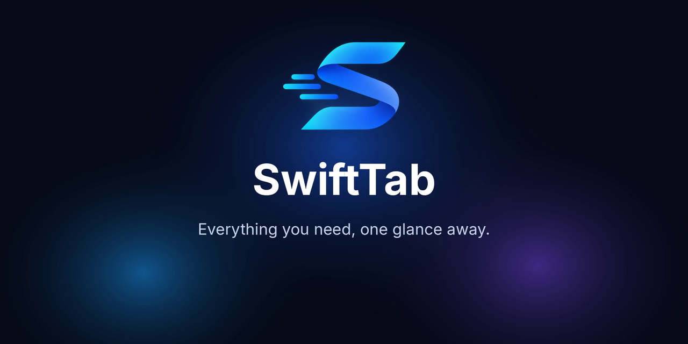
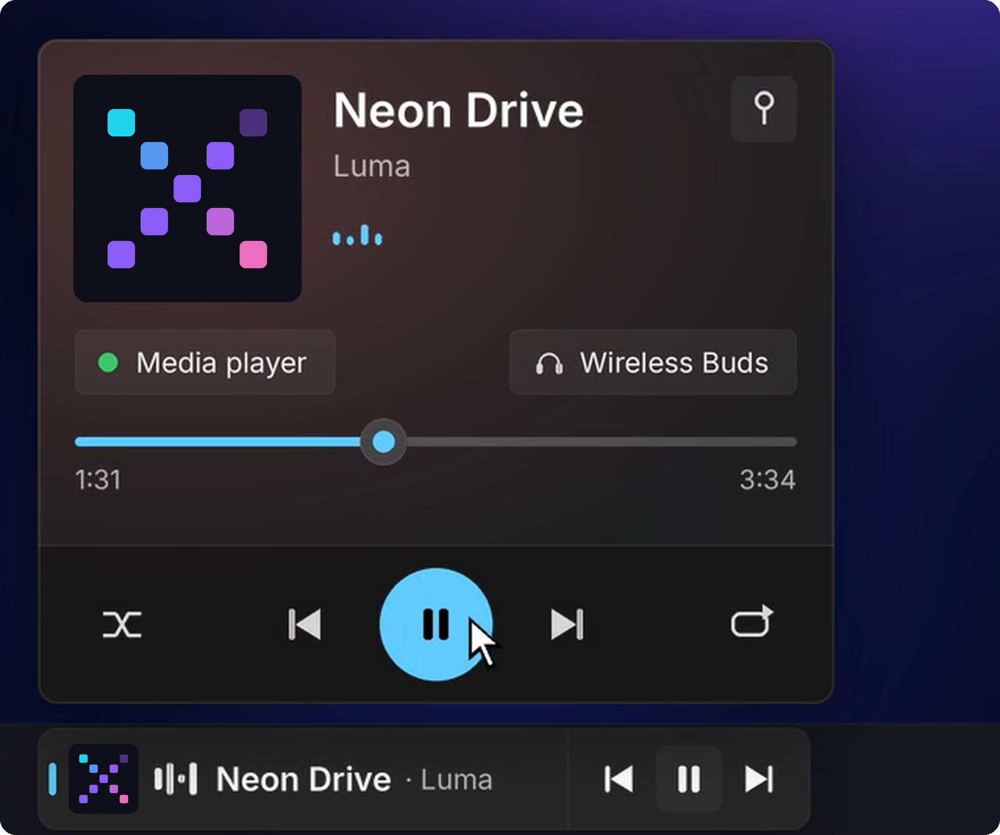
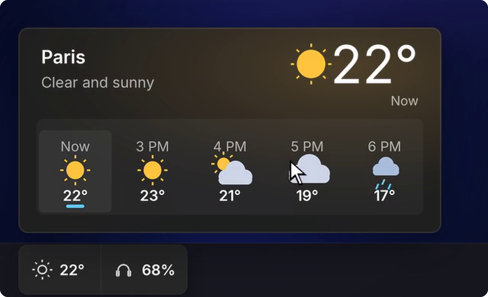
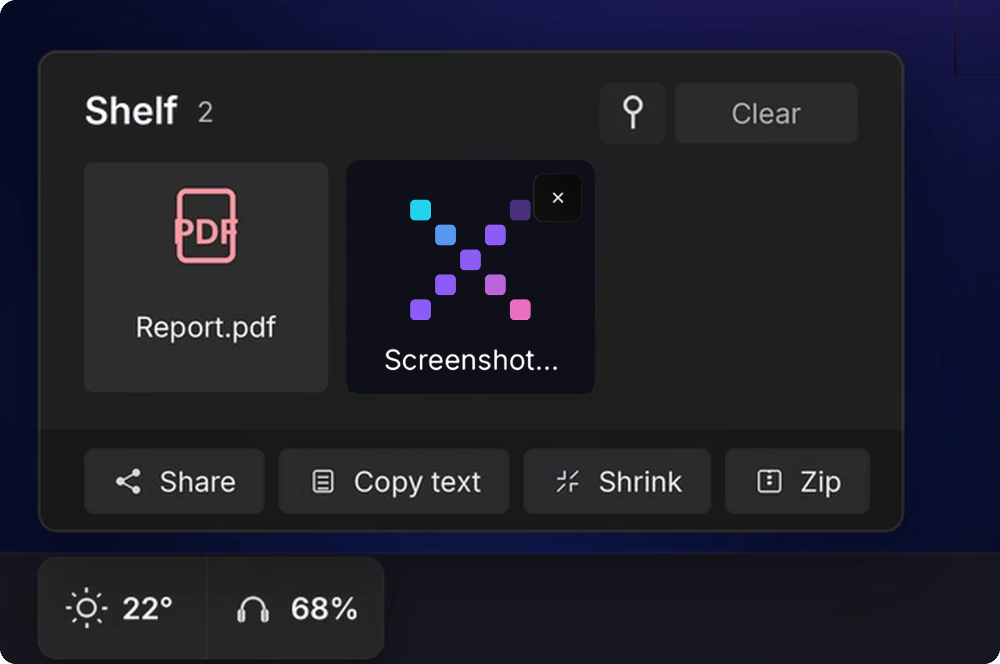
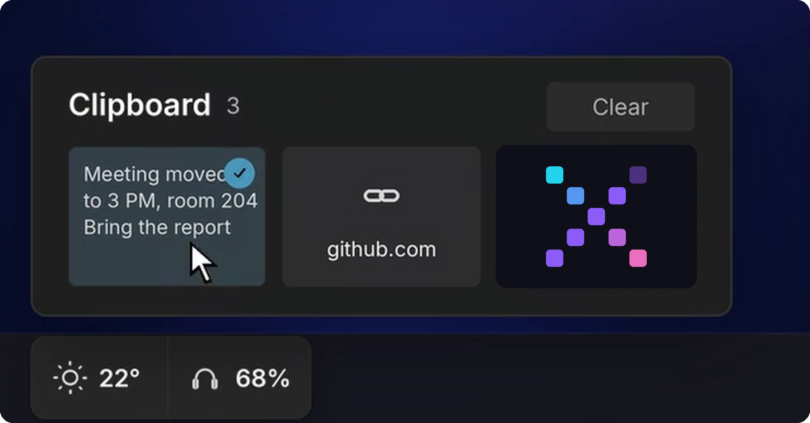
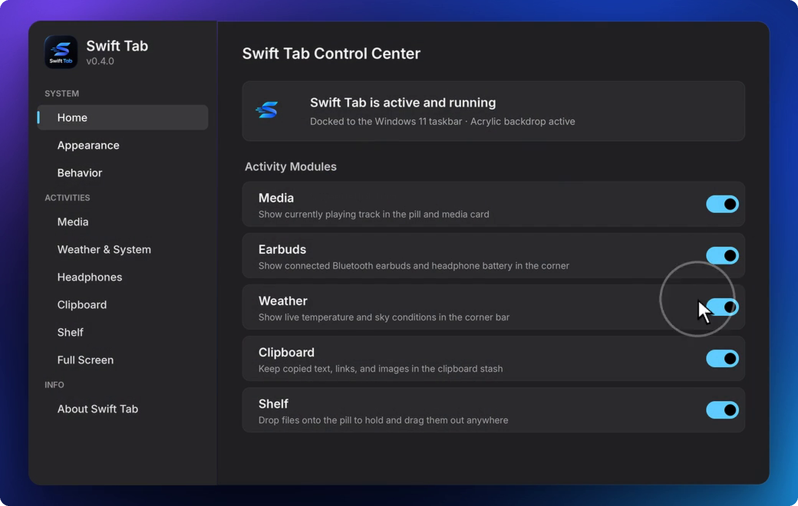

<div align="center">



<br>

**A sleek taskbar companion for Windows 11 & 10.**
Media, weather, downloads, earbuds, clipboard and files, all in live pills that live in your taskbar.

<br>

[](https://github.com/SeNsXD/Swift-Tab/releases/latest)
[](https://github.com/SeNsXD/Swift-Tab/releases)
[](#install)
[](https://www.rust-lang.org/)


[**Download**](https://github.com/SeNsXD/Swift-Tab/releases/latest) &nbsp;|&nbsp;
[Features](#features) &nbsp;|&nbsp;
[Controls](#controls) &nbsp;|&nbsp;
[Install](#install)

</div>

<br>

## What is Swift Tab?

Swift Tab docks into the Windows taskbar and shows what's happening right now as small **pills**. Click a pill and it opens into a full **card**: playback controls, a forecast, your clipboard, a shelf for files. Nothing to alt-tab to, nothing to keep open.

It's native Rust drawn with Direct2D and DirectWrite on an Acrylic backdrop, so it stays fast and light on resources.

<div align="center">

</div>

<br>

## Features

<table>
<tr>
<td width="50%" valign="top">

### Media, right in your taskbar
Controls for whatever is playing: Spotify, YouTube Music, your browser, and any app that uses Windows media sessions.

- Pill and card pick up colours from the album art
- Play, pause, skip, shuffle, repeat and a seek bar on the card
- See and switch the output device from the card
- Pin the card so it stays open

</td>
<td width="50%" valign="top">



</td>
</tr>
<tr>
<td width="50%" valign="top">



</td>
<td width="50%" valign="top">

### Weather and what's coming next
Live temperature and sky conditions in the corner of your taskbar, with an hourly forecast one click away.

</td>
</tr>
<tr>
<td width="50%" valign="top">

### A shelf for your files
Drop files on the pill now, drag them out later.

- New screenshots land on the shelf automatically
- One-click **Share**, **Copy text**, **Shrink** and **Zip**

</td>
<td width="50%" valign="top">



</td>
</tr>
<tr>
<td width="50%" valign="top">



</td>
<td width="50%" valign="top">

### Clipboard history
Text, links and images you copied, one click from your taskbar. Clear it whenever you like.

</td>
</tr>
</table>

### And more

| Feature | Details |
|---|---|
| **Earbuds & headphones** | Battery of your connected Bluetooth earbuds and headphones, always in the corner. |
| **Download progress** | Active downloads show in the pill. Click to open. |
| **File copy progress** | Explorer file copies show in the pill, even when Explorer is minimized. |
| **Screenshots** | New screenshots from ShareX and the Snipping Tool pop up in the pill and can go straight onto the shelf, ready to drag and drop later. |
| **Game downloads** | Progress and speed of Steam and Epic Games downloads in the pill, plus your playtime during and after a game. |
| **Privacy indicators** | The pill shows when your microphone or camera is in use. |
| **Idle pets** | When a pill is empty (nothing copied, nothing on the shelf, nothing playing), a tiny pixel cat or ghost wanders in the free space. It leaves as soon as something real shows up. |
| **Fullscreen friendly** | Hides in games, videos and presentations, with per-app exceptions. |

<br>

## Make it yours

<div align="center">

</div>

<br>

The **Control Center** lets you switch on only the modules you want, and tune how Swift Tab looks and behaves.

- **Modules**: turn Media, Earbuds, Weather, Clipboard, Shelf and more on or off
- **Appearance**: pill size, card blur, Dark / Light / System theme
- **Behavior**: start with Windows, tray click action, alignment, animation speed
- **Full screen**: choose which apps should or shouldn't hide the pill

<br>

## Controls

| Action | What it does |
|---|---|
| **Click** a pill | Open or dismiss its card |
| **Middle-click** a pill | Play / pause media |
| **Scroll** over the pills | Cycle through everything that's active |
| **Right-click** a pill | Context menu |

<br>

## Install

**Recommended:** grab **`swifttab-setup.exe`** from the [latest release](https://github.com/SeNsXD/Swift-Tab/releases/latest) and run it.

- Installs for your user only (`%LOCALAPPDATA%\Programs\SwiftTab`), **no administrator rights needed**
- Choose launch on startup, a desktop shortcut and more in the setup window
- Updates itself from GitHub Releases, verifying each download against `SHA256SUMS.txt`

```powershell
# Silent install
swifttab-setup.exe --quiet
```

**Requirements:** Windows 11, or Windows 10 version 1809 or later.

<details>
<summary><b>Verify your download</b></summary>

<br>

Every release ships a `SHA256SUMS.txt`. In PowerShell:

```powershell
Get-FileHash .\swifttab-setup.exe -Algorithm SHA256
```

Compare the result with the matching line in `SHA256SUMS.txt`.

</details>

<br>

## Credits

- **Concept**: inspired by the original **Now Bar** taskbar-companion idea
- **UI**: the settings window is built with [Slint](https://slint.dev/); type is Segoe UI Variable and [Inter](https://rsms.me/inter/) (SIL OFL)

<br>

<div align="center">

**Made by [XDNOT Labs](https://github.com/SeNsXD)**

Swift Tab is free to use. All rights reserved.

</div>
