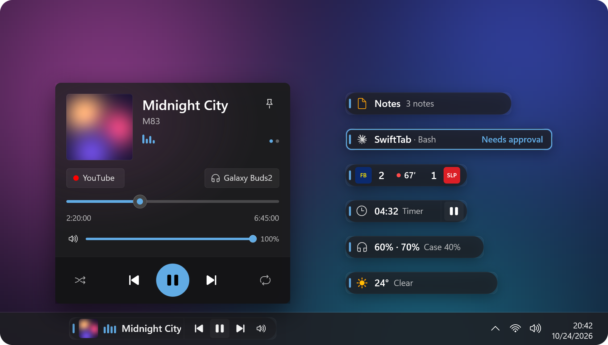

<div align="center">



# Swift Tab

**A compact, fluid taskbar companion with dynamic pills and interactive cards for Windows 11 & 10.**

[](https://github.com/SeNsXD/Swift-Tab/releases/latest)
[](https://github.com/SeNsXD/Swift-Tab)
[](https://www.rust-lang.org/)
[](LICENSE)

Swift Tab docks seamlessly into your Windows taskbar, presenting dynamic status pills and expandable flyout cards for your media, active browser downloads, live weather, clipboard history, file drops, and connected audio devices.

[**Download Latest Release**](#installation) &nbsp;·&nbsp;
[Features](#features) &nbsp;·&nbsp;
[Keyboard Shortcuts](#keyboard-shortcuts) &nbsp;·&nbsp;
[Building](#building-from-source) &nbsp;·&nbsp;
[Credits](#credits--acknowledgments)

</div>

<br>

---

## Highlights

<div align="center">

</div>

* **Native Windows Direct2D Engine**: Built directly into the taskbar (`Shell_TrayWnd`) using Direct2D, DirectWrite, and `Windows.UI.Composition` APIs with Acrylic backdrops. Fast, responsive, and lightweight (< 40 MB RAM idle).
* **Dynamic Priority Stacking**: Shows active tasks (downloads, playing tracks, weather alerts) with smooth transitions, while letting you scroll through active cards using your mouse wheel.
* **Fullscreen Friendly**: Automatically conceals itself when running games, presentations, or full-screen video players (with customizable application exceptions).

---

## Features

### ⬇️ Live Download Monitor
* **Multi-Browser Tracking**: Automatically monitors active downloads across Google Chrome, Microsoft Edge, Brave, Opera, and Firefox.
* **Exact Progress & Transfer Speed**: Displays the true target filename, live transfer rate, ETA, and exact byte progress (e.g. `1.4 MB / 4.7 GB (0%) · 722 KB/s · 49m left`).
* **Progress Ring & Card**: Circular progress ring directly around the taskbar download arrow and full progress bar on the expanded card.
* **Dedicated Quick Actions**:
  * **Open**: Immediately brings the browser actively downloading the file to the foreground.
  * **Folder**: Opens your download directory in File Explorer and highlights the completed file.
  * **Right-Click**: Right-clicking the pill gives quick access to open the download folder.

### 🎵 Universal Media & Live Lyrics
* **Media Sessions**: Works seamlessly with Spotify, YouTube Music, Apple Music, Tidal, web browsers, and any app using Windows Media Sessions.
* **Dynamic Album Accents**: The pill and card automatically extract color palettes from the current album art for fluid gradients.
* **Synchronized Live Lyrics**: Sourced in real time from `lrclib.net` and scrolling smoothly alongside playback.
* **Output Device Selector**: Switch playback between headphones, speakers, or Bluetooth devices right from the media card.
* **Always Show Media**: Option to keep the media pill docked even when paused.

### 🌤️ Weather & Severe Alerts
* **Current Conditions & Hourly Forecast**: Real-time temperature, condition summaries, and hour-by-hour forecast with clean vector weather icons.
* **Hazard & Weather Alerts**: Instant alerts for rain, snow, storms, high winds, and severe temperature changes.
* **Flexible Location**: Auto-detects location via Windows Location Services or lets you specify a custom city.

### 📋 Clipboard History
* **Taskbar Clipboard Stash**: Quickly preview your recent copied text, links, and image clips.
* **Pinning**: Pin frequently needed snippets so they remain at the top of your history.
* **Plain Text Pasting**: Re-paste clips stripped of unwanted rich text formatting.

### 📁 Drag-and-Drop Shelf
* **Transient File Stash**: Drag files directly onto the taskbar pill to hold them temporarily, then drag them anywhere when needed.
* **Screenshot Auto-Capture**: Automatically captures newly taken screenshots onto the shelf.
* **Quick Tools**: Share to phone (Windows Share / Quick Share), extract OCR text from images, downscale photos, or batch Zip items.

### 🎧 Earbuds & Bluetooth Audio
* **Battery Monitoring**: Live battery percentages for left earbud, right earbud, and charging cradle (Galaxy Buds and standard Bluetooth headsets).
* **Noise Control**: Toggle between Active Noise Canceling (ANC), Ambient Sound, and Off.

### 🎮 Games
* Detects running games and monitors download/update states for Steam and Epic Games.

### ⚙️ System Events & Privacy
* Real-time indicators for volume adjustments, low battery warnings, and Explorer file transfers.

---

## Settings & Customization

<div align="center">

</div>

* **Appearance**: Choose between Compact, Standard, or Large pill sizes, configure card blur (Acrylic backdrop), and toggle Dark, Light, or System theme.
* **Behavior**: Configure autostart with Windows, tray click actions, and taskbar alignment.
* **Full Screen Exceptions**: Manage apps that should or shouldn't suppress the pill during fullscreen mode.

---

## Keyboard Shortcuts

| Shortcut / Action | Function |
|---|---|
| **Click Pill** | Open or dismiss the current companion card |
| **Middle-Click Pill** | Play / Pause active media playback |
| **Mouse Wheel on Pill** | Cycle through multiple active activities in the stack |
| **Right-Click Pill** | Context menu (e.g. Open download folder, switch audio output) |
| <kbd>Win</kbd> + <kbd>Alt</kbd> + <kbd>N</kbd> | Open quick timer and stopwatch picker |
| <kbd>Ctrl</kbd> + <kbd>F</kbd> *(in Settings)* | Search settings, options, and apps |
| <kbd>Ctrl</kbd> + <kbd>K</kbd> *(in Settings)* | Open Command Palette |

---

## Installation

### Pre-built Setup (Recommended)

1. Download the latest installer from [**Releases**](https://github.com/SeNsXD/Swift-Tab/releases/latest).
2. Run `swifttab-setup.exe`. It installs locally to `%LOCALAPPDATA%\Programs\SwiftTab` without requiring administrator privileges.
3. Configure your preferences (Launch on startup, Desktop shortcut, etc.).

*Silent Installation:*
```powershell
swifttab-setup.exe --quiet
```

---

## Building from Source

### Prerequisites
* **Rust**: Latest stable toolchain (`x86_64-pc-windows-msvc`).
* **Windows SDK**: Provides `rc.exe` for icon and manifest resource embedding.
* Windows 10 (version 1809+) or Windows 11.

### Quick Build
```powershell
git clone https://github.com/SeNsXD/Swift-Tab.git
cd Swift-Tab
cargo build --profile quick --bin swifttab --bin swifttab-settings
```

Binaries will be output to:
* `target\quick\swifttab.exe` (main companion)
* `target\quick\swifttab-settings.exe` (settings GUI)

### Distribution Packaging
```powershell
powershell -ExecutionPolicy Bypass -File tools\make-setup.ps1
```

---

## Credits & Acknowledgments

* **Concept & Inspiration**: Credit to the original **Now Bar** project for the taskbar companion idea and concept.
* **UI Framework**: Settings interface built with [Slint](https://slint.dev/) and typography powered by Segoe UI Variable and Inter.

---

## License

Swift Tab is open-source software licensed under the [GNU General Public License v3.0](LICENSE).
