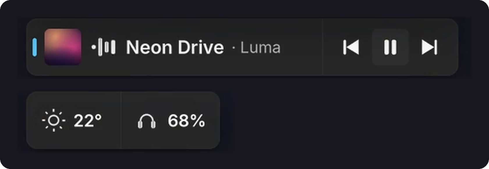

<div align="center">


<br>

**A sleek taskbar companion for Windows 11 & 10.**
Media, weather, downloads, earbuds, clipboard and files, all in live pills that live in your taskbar.

<br>

[](https://github.com/SeNsXD/Swift-Tab/releases/latest)
[](https://github.com/SeNsXD/Swift-Tab/releases)
[](#install)
[](https://www.rust-lang.org/)
[](LICENSE)

[**⬇️ Download**](https://github.com/SeNsXD/Swift-Tab/releases/latest) &nbsp;·&nbsp;
[Features](#features) &nbsp;·&nbsp;
[Shortcuts](#controls--shortcuts) &nbsp;·&nbsp;
[Claude Code](#claude-code) &nbsp;·&nbsp;
[Notifications API](#notifications-api-for-developers) &nbsp;·&nbsp;
[Build](#build-from-source)

</div>

<br>

## What is Swift Tab?

Swift Tab docks into the Windows taskbar and shows what's happening right now as small **pills**. Click a pill and it opens into a full **card**: playback controls, a forecast, your clipboard, a shelf for files. Nothing to alt-tab to, nothing to keep open.

It's native Rust drawn with Direct2D and DirectWrite on an Acrylic backdrop, so it stays fast and light on resources.

<div align="center">

</div>

<br>

## Features

<table>
<tr>
<td width="50%" valign="top">

### 🎵 Media, right in your taskbar
Controls for Spotify, YouTube Music, Apple Music, Tidal, your browser, and anything that uses Windows media sessions.

- Album-art accent colours on the pill and card
- Synced live lyrics (via [lrclib.net](https://lrclib.net))
- Switch the output device (speakers, headphones, Bluetooth) from the card
- Optional: keep the pill docked while paused

</td>
<td width="50%" valign="top">


</td>
</tr>
<tr>
<td width="50%" valign="top">


</td>
<td width="50%" valign="top">

### 🌤️ Weather and what's coming next
Current conditions in the corner, with an hourly forecast one click away.

- Alerts for rain, snow, storms, strong wind and sharp temperature changes
- Auto-locates through Windows Location Services, or set a city yourself

</td>
</tr>
<tr>
<td width="50%" valign="top">

### 📁 A shelf for your files
Drop files on the pill now, drag them out later.

- New screenshots land on the shelf automatically
- One-click **Share**, **Copy text** (OCR), **Shrink** (downscale) and **Zip**

</td>
<td width="50%" valign="top">


</td>
</tr>
<tr>
<td width="50%" valign="top">


</td>
<td width="50%" valign="top">

### 📋 Clipboard history
Text, links and images you copied, one click from your taskbar.

- Pin the clips you keep reaching for
- Paste as plain text, without the formatting

</td>
</tr>
</table>

### And more

| | |
|---|---|
| ⬇️ **Download monitor** | Live progress ring, speed, ETA and exact bytes for Chrome, Edge, Brave, Opera and Firefox. Open the browser or reveal the file in Explorer from the card. |
| 🎧 **Earbuds & Bluetooth** | Battery for left bud, right bud and case (Galaxy Buds and standard Bluetooth headsets), plus ANC / Ambient / Off. |
| ⏱️ **Timers** | Quick timer and stopwatch picker from the taskbar. |
| ⚽ **Live matches** | Follow a football club or a EuroLeague / EuroCup basketball team: live score, minute or quarter, goals and cards. |
| 🎮 **Games** | Detects running games and tracks Steam and Epic download / update progress and play time, read locally. |
| 🧘 **Digital Wellbeing** | Screen time per app, today and over recent days, with limits. |
| 🌙 **While you were away** | A short recap of what happened while your PC was locked. |
| 🔋 **System moments** | Volume, charging, low battery, and active microphone / camera indicators. |
| 🕹️ **Fullscreen friendly** | Hides in games, videos and presentations (with per-app exceptions). Urgent things drop in briefly from the top of the screen. |

<br>

## Make it yours

<div align="center">

</div>

<br>

The **Control Center** lets you switch on only the modules you want.

- **Appearance**: pill size (Compact, Standard, Large), card blur, Dark / Light / System theme
- **Behavior**: start with Windows, tray click action, alignment, animation speed
- **Full screen**: choose which apps should or shouldn't hide the pill
- **Search & command palette**: <kbd>Ctrl</kbd>+<kbd>F</kbd> to search settings, <kbd>Ctrl</kbd>+<kbd>K</kbd> for the command palette

<br>

## Controls & shortcuts

| Action | What it does |
|---|---|
| **Click** a pill | Open or dismiss its card |
| **Middle-click** a pill | Play / pause media |
| **Scroll** over the pills | Cycle through everything that's active |
| **Right-click** a pill | Context menu (open download folder, switch audio output, …) |
| <kbd>Win</kbd>+<kbd>Alt</kbd>+<kbd>N</kbd> | Quick timer and stopwatch picker |
| <kbd>Win</kbd>+<kbd>Alt</kbd>+<kbd>C</kbd> | Ask Claude a quick question |

Both hotkeys can be changed in Settings.

<br>

## Install

**Recommended:** grab **`swifttab-setup.exe`** from the [latest release](https://github.com/SeNsXD/Swift-Tab/releases/latest) and run it.

- Installs for your user only (`%LOCALAPPDATA%\Programs\SwiftTab`), **no administrator rights needed**
- Choose launch on startup, a desktop shortcut and more in the setup window
- Updates itself from GitHub Releases, verifying each download against `SHA256SUMS.txt`

```powershell
# Silent install
swifttab-setup.exe --quiet
```

**Requirements:** Windows 11, or Windows 10 version 1809 or later.

<details>
<summary><b>Verify your download</b></summary>

<br>

Every release ships a `SHA256SUMS.txt`. In PowerShell:

```powershell
Get-FileHash .\swifttab-setup.exe -Algorithm SHA256
```

Compare the result with the matching line in `SHA256SUMS.txt`.

</details>

<br>

## Claude Code

If you use [Claude Code](https://claude.com/product/claude-code), Swift Tab can show its permission requests and activity in the pill, so you can approve a command without switching windows.

```powershell
swifttab.exe claude-hooks install   # add the hooks
swifttab.exe claude-hooks remove    # take them out again
```

You can also turn it on from the setup window or Settings. It only edits the `hooks` section of Claude Code's settings.

<br>

## Notifications API (for developers)

Any app on your PC can put a notification or a live activity (a backup at 40%, a build, a download) in the pill with one local HTTP request:

```bash
curl -H "Content-Type: application/json" \
     -d '{"app":"Backup","title":"Backup done","text":"12 files, 48 MB"}' \
     http://127.0.0.1:20034/v1/notify
```

- **Off until you turn it on** (setup or Settings → System → App notifications)
- **Local only**: listens on `127.0.0.1` / `[::1]`, never on your network
- **You approve each app** the first time it asks

Full reference: [**DOCS.md**](DOCS.md)

<br>

## Build from source

**You'll need:** the latest stable Rust toolchain (`x86_64-pc-windows-msvc`) and the Windows SDK (for `rc.exe`, which embeds the icon and manifest).

```powershell
git clone https://github.com/SeNsXD/Swift-Tab.git
cd Swift-Tab
cargo build --profile quick --bin swifttab --bin swifttab-settings
```

Output: `target\quick\swifttab.exe` (the companion) and `target\quick\swifttab-settings.exe` (Control Center).

Build the installer and release files into `dist\`:

```powershell
powershell -ExecutionPolicy Bypass -File tools\make-setup.ps1
```

<br>

## Credits

- **Concept**: inspired by the original **Now Bar** taskbar-companion idea
- **UI**: the settings window is built with [Slint](https://slint.dev/); type is Segoe UI Variable and [Inter](https://rsms.me/inter/) (SIL OFL)
- **Data**: lyrics from [lrclib.net](https://lrclib.net)

<br>

<div align="center">

**Made by [XDNOT Labs](https://github.com/SeNsXD)**

Swift Tab is free software, licensed under the [GNU GPL v3.0](LICENSE).

</div>
