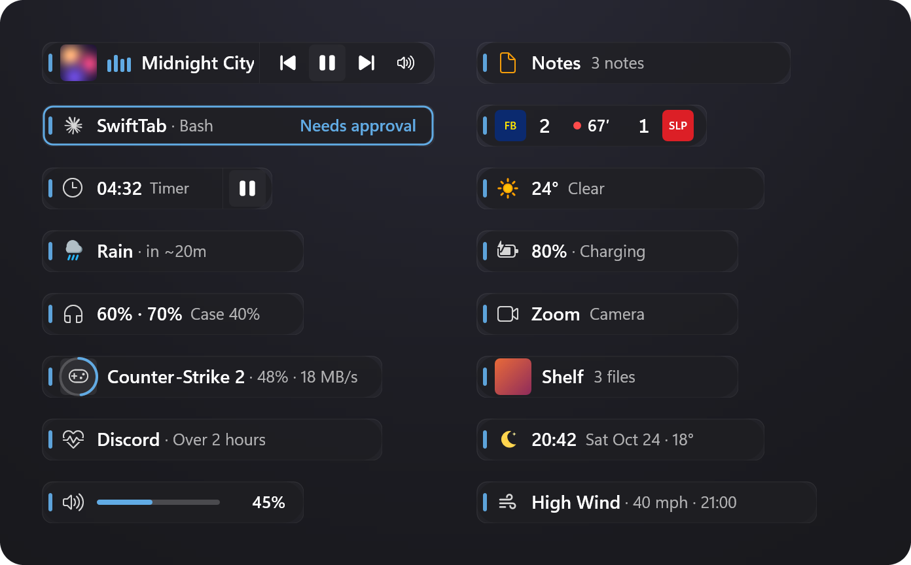
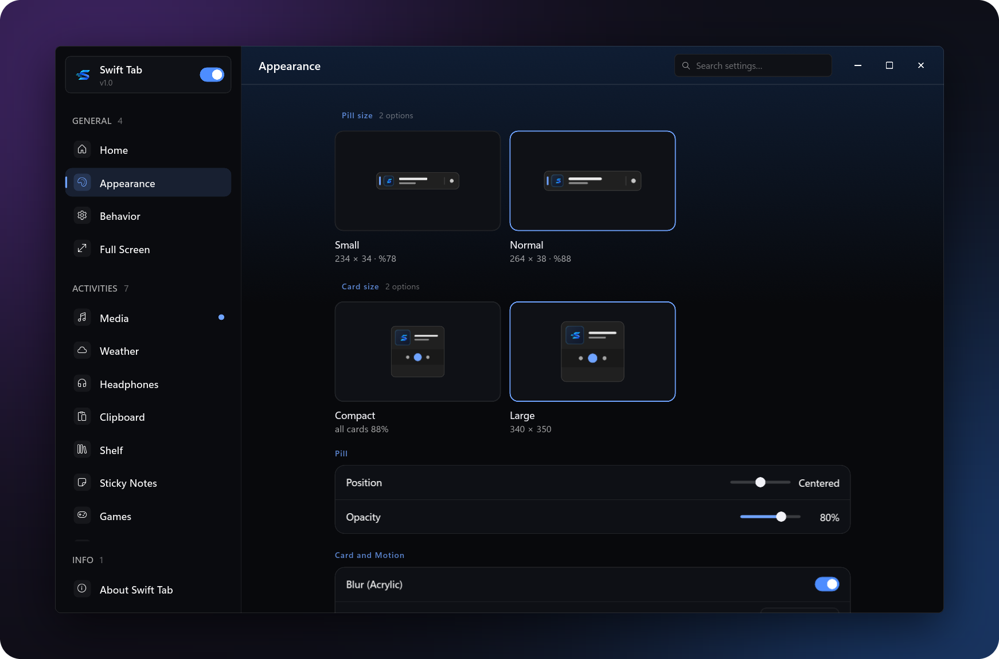

<div align="center">


# SwiftTab

**The ultimate dynamic taskbar companion & productivity island for Windows 11 & 10.**

[](https://github.com/SeNsXD/Swift-Tab/releases/latest)
[](https://github.com/SeNsXD/Swift-Tab)
[](https://www.rust-lang.org/)
[](LICENSE)
[](https://github.com/SeNsXD/Swift-Tab/releases)

SwiftTab seamlessly docks into your Windows taskbar, presenting intelligent status pills and expandable flyout cards for your sticky notes, media playback, clipboard history, file drops, active browser downloads, live weather, and Bluetooth accessories.

[**Download Latest Release**](#-installation) &nbsp;·&nbsp;
[Features](#-features) &nbsp;·&nbsp;
[Keyboard Shortcuts](#-keyboard-shortcuts--gestures) &nbsp;·&nbsp;
[Building](#-building-from-source) &nbsp;·&nbsp;
[License](#-license)

</div>

<br>

---

## 🌟 Highlights

<div align="center">

</div>

* **Engineered for Speed in Rust**: Direct Win32 and Direct2D hardware-accelerated rendering. Highly optimized with tiny memory usage (< 40 MB RAM idle) and zero background CPU wakeups.
* **Fluid 60/120/144Hz Animations**: Smooth spring dynamics, cubic-bezier ease transitions, and native Windows 11 Acrylic materials that match your desktop aesthetic.
* **Intuitive Wheel Carousel**: Scroll your mouse wheel directly over the taskbar pill to effortlessly glide between your active media, sticky notes, clipboard stash, and file shelf.
* **Smart Taskbar Integration**: Perfectly positions itself alongside centered or left-aligned Windows 11 & 10 taskbar icons, with automatic compensation for taskbar buttons and tray overflow.
* **Fullscreen Friendly**: Automatically conceals itself when playing games, delivering presentations, or watching videos in full screen (with custom application rules).

---

## ✨ Features

### 📝 Sticky Notes & Scratchpad
* **Instant Taskbar Notes**: Keep your quick thoughts, todo lists, and draft texts right inside your taskbar.
* **Multiline Editor**: Full multiline cursor navigation with arrow keys (<kbd>↑</kbd>, <kbd>↓</kbd>, <kbd>←</kbd>, <kbd>→</kbd>), selection, copy/paste, and undo.
* **Auto-Save Everywhere**: Automatically persists all notes to JSON on every keystroke — never lose a thought.
* **Floating & Translucent**: Float a note anywhere on your screen with customizable translucency so you can reference instructions while typing in another app.
* **Quick Note Shortcut**: Middle-click the pill or click the `+` button to instantly create a new note in less than a second.

### 🎵 Universal Media & Synchronized Lyrics
* **Universal Compatibility**: Works seamlessly with Spotify, YouTube Music, Apple Music, Tidal, SoundCloud, web browsers, and any app using Windows Media Sessions.
* **Dynamic Palette Extraction**: Extracts vibrant color gradients directly from the current track's album art.
* **Real-time Equalizer**: 4-bar audio visualizer that syncs dynamically with your Windows accent color.
* **Live Synced Lyrics**: Real-time scrolling lyrics sourced automatically from LRCLIB.
* **Audio Output Switcher**: Switch playback between headphones, speakers, or Bluetooth devices right from the media card.
* **Transport Controls**: Play/pause, track skip, previous track, and dedicated volume/mute buttons.

### 📋 Smart Clipboard History
* **Visual Stash**: Quickly preview your recent copied text clippings, web URLs, and image captures.
* **Pinning**: Pin frequently needed snippets (code snippets, addresses, boilerplates) to keep them permanently at the top.
* **Plain Text Pasting**: Re-copy any formatted snippet as clean plain text with one click.
* **Privacy Focused**: Everything is stored locally on your machine with easy one-click history clearing.

### 📁 Drag-and-Drop Shelf
* **Transient File Stash**: Drag files directly onto the taskbar pill to hold them in a temporary shelf, then drag them anywhere whenever you're ready.
* **Auto Screenshot Capture**: Automatically collects newly captured screenshots into the shelf for rapid sharing.
* **Built-in Power Tools**: One-click OCR text extraction from images, image downscaling, batch Zip archive creation, and native Windows Share.

### 🌤️ Live Weather & Severe Alerts
* **Compact Taskbar Chip**: Real-time temperature display and weather condition glyph beside the pill.
* **Hourly Forecast Card**: Detailed hour-by-hour forecast, precipitation chances, and atmospheric data.
* **Dynamic Weather Accents**: Sky condition coloring that mirrors sunshine, rain, snow, or thunderstorms.
* **Hazard & Severe Alerts**: Proactive warnings for sudden rain, thunderstorms, extreme wind, or severe temperature drops.

### ⬇️ Multi-Browser Live Download Monitor
* **Multi-Browser Tracking**: Automatically monitors active downloads across Google Chrome, Microsoft Edge, Brave, Opera, and Firefox.
* **Accurate Progress & Speed**: Displays live transfer rate, ETA, and progress percentage.
* **Quick Actions**: One-click button to jump directly to the downloading browser or open the target download folder in File Explorer.

### 🎧 Earbuds & Bluetooth Audio
* **Battery Percentages**: View independent battery levels for left earbud, right earbud, and charging case (Galaxy Buds and standard Bluetooth headsets).
* **Noise Control**: Toggle between Active Noise Cancellation (ANC), Ambient Sound, and Off.
* **Quick Disconnect**: Right-click the battery segment to disconnect your Bluetooth device without digging through Windows Settings.

### ⏱️ Quick Timers & Stopwatch
* **Fast Activation**: Launch with <kbd>Win</kbd> + <kbd>Alt</kbd> + <kbd>N</kbd> or from the system tray.
* **Presets & Custom Times**: Quick presets (1, 3, 5, 10, 15, 30 min) or custom countdown timers with audible alarms.
* **High-Precision Stopwatch**: Measures elapsed time down to tenths of a second with pause/resume controls.

### ⚽ Live Sports Scores
* **Real-time Match Tracker**: Follow your favorite football and basketball teams with live score updates, match minute indicators, and goal moment celebrations.

### 📊 Digital Wellbeing & Screen Time
* **Daily App Usage**: Visual breakdown of your most-used applications throughout the day.
* **Custom App Limits**: Set daily time limits on distracting applications with notification alerts when reached.
* **Music Recap**: Weekly recap of your top listened songs and artists.

### 🤖 AI Assistant Integration
* **Quick AI Query**: Press <kbd>Win</kbd> + <kbd>Alt</kbd> + <kbd>C</kbd> or <kbd>Ctrl</kbd> + click the pill to bring up an instant AI prompt card.

### 🏝️ Top Dynamic Island
* **Subtle System Moments**: An optional fluid island at the top of your display that animates smoothly down for transient alerts, volume adjustments, and system events.

---

## 🎨 Settings & Customization

<div align="center">

</div>

* **Pill Sizing**: Choose between **Normal** (Standard, 88%) and **Small** (Compact, 78%) sizing to match your taskbar density.
* **Visual Material**: Customize Acrylic blur, darkness, saturation, and custom hex accent colors (or sync automatically with your desktop wallpaper).
* **Behavior & Startup**: Toggle Windows startup launch, tray icon single/double click actions, and hover activation.
* **Fullscreen Exceptions**: Configure custom app exclusion rules to specify exactly which apps should or shouldn't conceal the pill during fullscreen mode.

---

## ⌨️ Keyboard Shortcuts & Gestures

| Shortcut / Gesture | Action |
|---|---|
| **Click Pill** | Open or dismiss the current companion card |
| **Mouse Wheel on Pill** | Cycle smoothly through active activities in the stack |
| **Middle-Click Pill** | On Notes: Create new note &middot; On Media: Play / Pause |
| **Right-Click Pill** | Context menu (New note, clear notes, download folder, Bluetooth) |
| **<kbd>↑</kbd> / <kbd>↓</kbd> Arrow Keys** *(in Note)* | Multiline note cursor navigation with column memory |
| **<kbd>Win</kbd> + <kbd>Alt</kbd> + <kbd>N</kbd>** | Open Timer & Stopwatch quick picker |
| **<kbd>Win</kbd> + <kbd>Alt</kbd> + <kbd>C</kbd>** | Open AI Assistant question card |
| **<kbd>Ctrl</kbd> + Click Pill** | Open AI Assistant question card directly |
| **<kbd>Ctrl</kbd> + <kbd>F</kbd>** *(in Settings)* | Search settings, options, and installed applications |
| **<kbd>Ctrl</kbd> + <kbd>K</kbd>** *(in Settings)* | Open Settings Command Palette |

---

## 📥 Installation

### Option 1: Native Setup Installer (Recommended)
1. Download `swifttab-setup.exe` from the latest [**GitHub Releases**](https://github.com/SeNsXD/Swift-Tab/releases/latest).
2. Run the installer. It installs locally to `%LOCALAPPDATA%\Programs\SwiftTab` without requiring administrator privileges.
3. Configure your preferences and you're good to go!

*For silent / enterprise installation:*
```powershell
swifttab-setup.exe --quiet
```

### Option 2: Portable Archive
1. Download `SwiftTab-v1.0.2-portable.zip`.
2. Extract anywhere and launch `swifttab.exe`.

### Option 3: Microsoft Store Package
* Download `SwiftTab.msix` from the release assets or install directly from the Microsoft Store.

---

## 🛠️ Building from Source

### Prerequisites
* **Rust**: Latest stable toolchain (`x86_64-pc-windows-msvc`).
* **Windows SDK**: Required for `rc.exe` (resource compiler) and Windows composition libraries.
* Windows 10 (version 1809 or higher) or Windows 11.

### Build Commands
```powershell
# Clone the repository
git clone https://github.com/SeNsXD/Swift-Tab.git
cd Swift-Tab

# Quick development build
cargo build --profile quick --bin swifttab --bin swifttab-settings

# Run test suite
cargo test --profile quick --lib

# Package production release & installer
powershell -ExecutionPolicy Bypass -File tools\make-setup.ps1
```

Compiled binaries will be generated in:
* `target\quick\swifttab.exe` &mdash; Main taskbar companion
* `target\quick\swifttab-settings.exe` &mdash; Slint settings application
* `dist\swifttab-setup.exe` &mdash; Production installer package

---

## 📜 License

SwiftTab is free and open-source software licensed under the [GNU General Public License v3.0](LICENSE).

---

<div align="center">
<sub>Crafted with ❤️ for Windows users who love clean, fast, and fluid desktop software.</sub>
</div>
