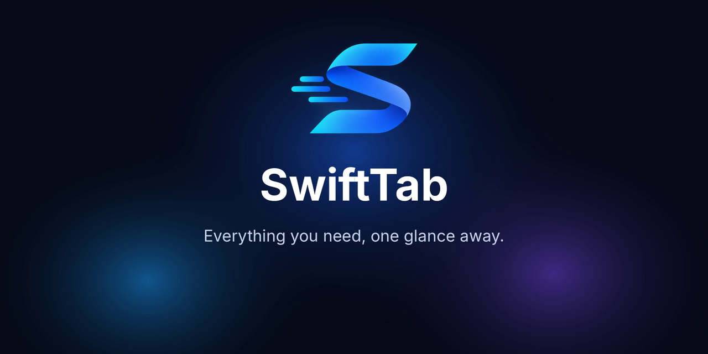

<div align="center">



# Swift Tab 1.0.0

**Everything you need, one glance away.**
A sleek taskbar companion for Windows 11 & 10.

</div>

---

## ⬇️ Download

| File | What it is |
|---|---|
| **`swifttab-setup.exe`** | **Recommended.** The installer. Per-user, no admin rights needed. |
| `swifttab.exe` | The taskbar companion on its own. |
| `swifttab-settings.exe` | The Control Center on its own. |
| `SHA256SUMS.txt` | Checksums for the files above. |

Run **`swifttab-setup.exe`**, pick your options, and Swift Tab appears in your taskbar. Silent install: `swifttab-setup.exe --quiet`

> Already running Swift Tab? It checks GitHub Releases for new versions and verifies each download against `SHA256SUMS.txt` before swapping itself in.

---

## ✨ What's new in 1.0.0

<!-- Edit this list to match what actually changed in this version. -->

- 

---

## 🧩 What Swift Tab does

- 🎵 **Media**: controls, album-colour accents, synced lyrics and an output-device switcher for Spotify, YouTube Music, Apple Music, Tidal, browsers and more
- 🌤️ **Weather**: current conditions, hourly forecast and severe-weather alerts
- ⬇️ **Downloads**: live progress, speed and ETA for Chrome, Edge, Brave, Opera and Firefox
- 📁 **Shelf**: drop files on the pill, drag them out later; Share, OCR, Shrink and Zip in one click
- 📋 **Clipboard history**: text, links and images, with pinning and plain-text paste
- 🎧 **Earbuds**: battery for each bud and the case, plus ANC / Ambient / Off
- ⏱️ **Timers**, ⚽ **live matches**, 🎮 **Steam & Epic activity**, 🧘 **screen time**, 🔋 **system moments**
- 🤖 **Claude Code** permission requests in the pill, and a **local notifications API** for your own apps (off until you enable it)

Turn on only the modules you want in the Control Center.

---

## 📋 Requirements

- Windows 11, or Windows 10 version 1809 or later

## 🔐 Verify your download

```powershell
Get-FileHash .\swifttab-setup.exe -Algorithm SHA256
```

Compare the result with the matching line in `SHA256SUMS.txt`.

---

## 🐛 Found a bug or have an idea?

Open an [issue](https://github.com/SeNsXD/Swift-Tab/issues) and include your Windows version.

Swift Tab is free software under the [GNU GPL v3.0](https://github.com/SeNsXD/Swift-Tab/blob/main/LICENSE). Made by **XDNOT Labs**.
